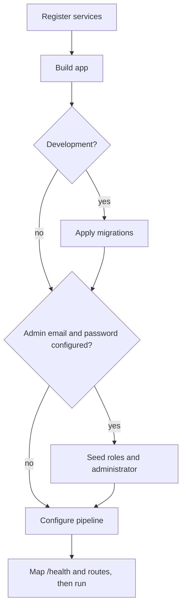

# Architecture

Inches Wig Store is a modular ASP.NET Core MVC application on .NET 10, backed by Microsoft SQL Server through Entity Framework Core 10. This document describes the structure that exists after milestone M1 (foundation, CI and database schema) and where the code of each later milestone goes. The requirements are in [`specification.md`](specification.md) and [`requirements.md`](requirements.md); the reasons for technical choices are in [`decisions.md`](decisions.md).

## 1. Layers

```text
Customer / Administrator
          |
          v
   ASP.NET Core MVC
          |
    +-----+----------+
    |                |
Controllers       Razor Views
    |
    v
Application Services
    |
    +-- Catalogue
    +-- Cart & Checkout
    +-- Orders
    +-- Payments
    +-- Inventory
    +-- Administration
    |
    v
Entity Framework Core
    |
    v
Microsoft SQL Server

External Integrations
    +-- Payment Gateway
    +-- Email Provider
```

Controllers handle web requests, services hold the business rules, and Entity Framework Core manages database access. Payment and email integrations are kept behind interfaces so a provider can be replaced without rewriting the application.

What exists after M1: the database layer (`Data/`, `Models/`), identity, the seeder, the health check, and the default Home page. Controllers, views and services for the shop are not built yet.

## 2. Project layout

```text
InchesWigStore/
|
+-- src/InchesWigStore.Web/
|   +-- Controllers/            HomeController (the default page)
|   +-- Data/
|   |   +-- AppDbContext.cs                 Identity context plus the DbSets
|   |   +-- AppDbContextFactory.cs          design-time factory, used only by the EF tools
|   |   +-- Configurations/                 one IEntityTypeConfiguration per entity
|   |   +-- Migrations/                     generated; never edited by hand
|   +-- Models/                 entities, enums, DeliveryAddressSnapshot
|   +-- Services/               AdminSeeder, IdentityDefaults, Roles
|   +-- Views/                  Home, Shared
|   +-- wwwroot/                css, js, lib
|   +-- Program.cs              composition root and startup
|   +-- appsettings.json
|
+-- tests/InchesWigStore.Tests/
|   +-- Data/                   schema tests (constraints, indexes, foreign keys)
|   +-- Services/               AdminSeederTests
|   +-- Web/                    HealthEndpointTests (WebApplicationFactory)
|   +-- Infrastructure/         SqlServerFixture, SqlAssert, TestData
|
+-- docs/                       specification, requirements, these documents, plans/
+-- prototypes/try-on/          the try-on prototype (not part of the build)
+-- .github/workflows/ci.yml    build, format check and tests on every pull request
+-- .editorconfig  Directory.Build.props  global.json  dotnet-tools.json
```

`Directory.Build.props` turns on nullable reference types, implicit usings, `TreatWarningsAsErrors`, `EnforceCodeStyleInBuild` and the latest recommended analysers for every project. `global.json` pins the SDK and `dotnet-tools.json` pins `dotnet-ef`.

The data model is described in [`database-design.md`](database-design.md).

## 3. Where later code goes

| Milestone | Code | Location |
|---|---|---|
| M2 Product Catalogue | Catalogue and search services, shop and product controllers and views, admin product and category management, image upload and validation | `Services/Catalogue/`, `Controllers/ShopController.cs`, `Views/Shop/`, `ViewModels/`, an `Admin` controller area with `Views/Admin/` |
| M2b Virtual Try-On | Browser script and the wig-picture tool; product page integration. The try-on runs in the browser and sends nothing to the server | `wwwroot/js/tryon/`, the product view; see `prototypes/try-on/` |
| M3 Cart and Checkout | Registration and sign-in pages, address management, cart service (including the visitor-to-account merge), checkout and order creation, stock reservation | `Controllers/AccountController.cs`, `CartController.cs`, `CheckoutController.cs`, `OrdersController.cs`; `Services/Cart/`, `Services/Checkout/`, `Services/Orders/`; matching `Views/` folders |
| M4 Payments | A payment-provider interface and one implementation, EFT workflow, notification endpoint that validates and de-duplicates | `Services/Payments/` (interface and implementations), a payment notification controller |
| M5 Admin and Order Management | Order and payment administration, inventory adjustments, status transitions, customer emails | `Services/Inventory/`, `Services/Orders/`, `Services/Notifications/`, `Views/Admin/` |
| M6 Testing and Deployment | Security headers, rate limiting, secret scanning in CI, deployment guide, backups | `Program.cs`, `.github/workflows/`, `docs/deployment-guide.md` |

A rule applies throughout: business rules live in services, which controllers call; controllers contain no business rules; views contain no data access. New services are registered in `Program.cs`.

## 4. Startup sequence

`Program.cs` is the composition root. At startup it does the following, in order.

1. Register the `AppDbContext` against `ConnectionStrings:DefaultConnection`, ASP.NET Core Identity (`ApplicationUser`, `IdentityRole<Guid>`, options from `IdentityDefaults`), the `AdminSeeder`, a health check on the database context, and MVC.
2. Build the app.
3. **In Development only,** apply pending migrations (`Database.MigrateAsync()`). In every other environment the deploy step applies migrations, and it must do so before the app starts (decision 6 in [`decisions.md`](decisions.md)).
4. **When both `Admin:Email` and `Admin:Password` are configured,** in any environment, run `AdminSeeder`: create the `Administrator` and `Customer` roles, and create the administrator, or repair the missing role of an existing user only when the configured password matches that account (otherwise log a warning without the email or password and promote nobody; decision 11). The password is never logged. If the credentials are not configured, nothing is seeded.
5. Configure the HTTP pipeline: exception handler and HSTS outside Development, HTTPS redirection, routing, authorisation, static assets.
6. Map `/health` and the default MVC route, then run.



### Configuration and secrets

Real values never go in `appsettings.json`. In development, use `dotnet user-secrets`; elsewhere use environment variables: `ConnectionStrings__DefaultConnection`, `Admin__Email`, `Admin__Password`. The default connection string in `appsettings.json` points at LocalDB and holds no secret.

### Health check

`GET /health` runs a database check and returns `200` with the text `Healthy`, or `503` with `Unhealthy` when the database cannot be reached (NFR-OPS-2). It returns no detail.

## 5. Test strategy

The tests are an xUnit project, `tests/InchesWigStore.Tests`. There are two kinds.

- **Unit tests** cover business rules that need no database: totals and rounding, cart rules, status transitions, payment handling (NFR-QUA-1). There are none yet; they arrive with the services in M3 to M5. `SmokeTests` only proves the test project references the web project.
- **Integration tests** run against a real SQL Server (NFR-QUA-2; decision 5 in [`decisions.md`](decisions.md)). They cover the schema, the seeder and the web host today, and checkout, stock under concurrency, payments and authorisation later.

**Fixture.** `SqlServerFixture` is an xUnit class fixture (`IClassFixture<SqlServerFixture>`). Each test class gets its own uniquely named database (`InchesWigStore_Test_<guid>`), created by applying all migrations, and dropped at the end of the class. The server comes from the `TEST_SQL_CONNECTION` environment variable, or LocalDB (`(localdb)\MSSQLLocalDB`) when it is not set. Tests in a class share the database, so each test creates its own uniquely identified data (`TestData`) rather than relying on an empty table.

**Schema tests** prove each database rule by trying to break it and asserting that SQL Server refused: the error number and the constraint or index name, through `SqlAssert`. `MigrationTests.Model_has_no_pending_changes` fails if the model and the migrations disagree. The full list is in the "Rules enforced by the database" table in [`database-design.md`](database-design.md).

**Web tests** use `WebApplicationFactory<Program>` with test configuration (connection string, optional admin credentials) to check `/health`, startup seeding, the home page and the Identity options.

**Continuous integration** (`.github/workflows/ci.yml`) runs on every pull request and on pushes to `main`: restore, `dotnet format --verify-no-changes`, a Release build (warnings are errors), and the tests against a SQL Server 2022 service container, with `TEST_SQL_CONNECTION` set. The container's password is a throwaway used only in the job.

To run the tests locally, install SQL Server LocalDB (it comes with Visual Studio) and run `dotnet test`.
