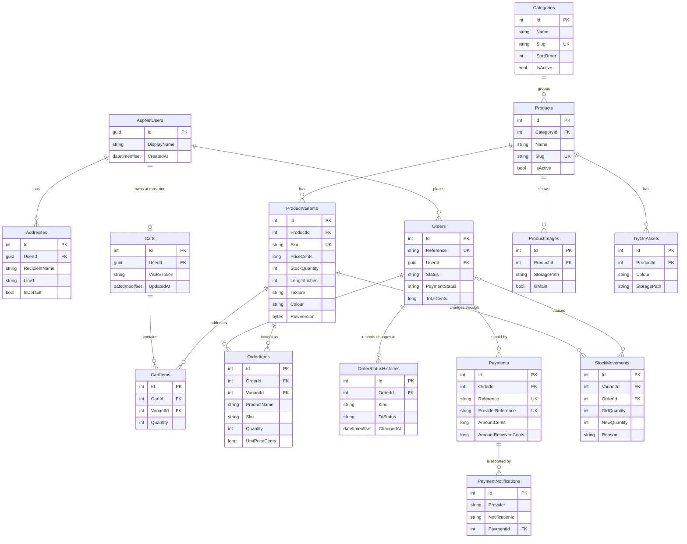

# Database design

This document describes the database as it exists after the four M1 migrations (`Catalogue`, `Addresses`, `CartsAndOrders`, `PaymentsAndStockMovements`). It was checked against the generated migrations and `AppDbContextModelSnapshot.cs`. If this document and the migrations ever disagree, the migrations win, and this document is wrong and must be fixed (NFR-QUA-6).

The business rules it serves are in [`specification.md`](specification.md) (`BR-n`) and [`requirements.md`](requirements.md) (`FR-` and `NFR-`).

## 1. Conventions

- **Engine:** Microsoft SQL Server, through Entity Framework Core 10 (pinned at 10.0.15). The default collation is case-insensitive, so unique text indexes (SKU, slugs) ignore case.
- **Money (BR-1):** whole cents in `bigint` columns whose names end in `Cents`. There is no `decimal` or floating-point money column.
- **Times:** `datetimeoffset`.
- **Enums:** stored as text (`nvarchar(20)`), not numbers, so the database is readable and reordering the C# enum cannot change stored meaning. There is no `CHECK` constraint on the allowed values; the application is the only writer of those values.
- **Keys:** `int` identity primary keys named `PK_<Table>`, except the Identity tables, which use `uniqueidentifier` keys.
- **Foreign keys:** named by EF Core as `FK_<DependentTable>_<PrincipalTable>_<Column>`. Every foreign key is `Restrict` (the database refuses to delete a parent that has children), except `OrderItems` to `Orders`, which is `Cascade`, and the ASP.NET Identity tables' own foreign keys, which keep the framework's cascades. See decision 3 in [`decisions.md`](decisions.md).
- **Names:** tables are plural. Check constraints are `CK_<Table>_<Rule>` and indexes are `IX_<Table>_<Columns>`. The two catalogue check constraints use the singular `CK_ProductVariant_...` (they were named first); every later one uses the plural table name. See the [style guide](style-guide.md).
- **Relationship to the specification:** spec section 7 calls the status-change entity `OrderStatusHistory`; the table EF Core created is `OrderStatusHistories`.

## 2. Entity-relationship diagram

The diagram shows keys and the columns that matter for relationships. Section 3 lists every column. `UK` marks a column that is unique on its own; composite and filtered unique indexes are listed in section 3.

## 3. Tables

Column types are shown as the SQL Server type. "Req" means `NOT NULL`.

### 3.1 AspNetUsers (ApplicationUser, ASP.NET Core Identity)

The standard Identity columns (`UserName`, `NormalizedUserName`, `Email`, `NormalizedEmail`, `EmailConfirmed`, `PasswordHash`, `SecurityStamp`, `ConcurrencyStamp`, `PhoneNumber`, `PhoneNumberConfirmed`, `TwoFactorEnabled`, `LockoutEnd`, `LockoutEnabled`, `AccessFailedCount`) plus two of ours. The key is `Guid`. The other Identity tables are `AspNetRoles`, `AspNetUserRoles`, `AspNetUserClaims`, `AspNetRoleClaims`, `AspNetUserLogins` and `AspNetUserTokens`, unchanged from the framework (their foreign keys cascade, as the framework defines them).

| Column | Type | Notes |
|---|---|---|
| Id | uniqueidentifier, req | `PK_AspNetUsers` |
| DisplayName | nvarchar(200), req | ours |
| CreatedAt | datetimeoffset, req | ours |

Indexes: `EmailIndex` (on `NormalizedEmail`) and `UserNameIndex` (unique, filtered `[NormalizedUserName] IS NOT NULL`), both from Identity. Identity options set in code (`IdentityDefaults`): password length 12, lock-out after 5 failed attempts for 15 minutes, unique email (FR-ACC-2, FR-ACC-3).

### 3.2 Categories

| Column | Type | Notes |
|---|---|---|
| Id | int identity, req | `PK_Categories` |
| Name | nvarchar(200), req | |
| Slug | nvarchar(100), req | |
| SortOrder | int, req | |
| IsActive | bit, req | |

Indexes: `IX_Categories_Slug` (unique).

### 3.3 Products

| Column | Type | Notes |
|---|---|---|
| Id | int identity, req | `PK_Products` |
| CategoryId | int, req | `FK_Products_Categories_CategoryId`, Restrict |
| Name | nvarchar(200), req | |
| Slug | nvarchar(100), req | |
| Description | nvarchar(4000), req | |
| IsActive | bit, req | products are deactivated, never deleted |
| CreatedAt | datetimeoffset, req | |

Indexes: `IX_Products_Slug` (unique), `IX_Products_CategoryId_IsActive`.

### 3.4 ProductVariants

| Column | Type | Notes |
|---|---|---|
| Id | int identity, req | `PK_ProductVariants` |
| ProductId | int, req | `FK_ProductVariants_Products_ProductId`, Restrict |
| Sku | nvarchar(64), req | |
| PriceCents | bigint, req | |
| StockQuantity | int, req | |
| IsActive | bit, req | |
| LengthInches | int, null | option |
| Texture | nvarchar(50), null | option |
| Colour | nvarchar(50), null | option |
| Density | nvarchar(50), null | option |
| CapSize | nvarchar(50), null | option |
| LaceType | nvarchar(50), null | option |
| Size | nvarchar(50), null | option |
| Style | nvarchar(50), null | option |
| RowVersion | rowversion, req | optimistic concurrency token |

Check constraints: `CK_ProductVariant_Price_NonNegative` (`[PriceCents] >= 0`), `CK_ProductVariant_Stock_NonNegative` (`[StockQuantity] >= 0`).

Indexes:

- `IX_ProductVariants_Sku` (unique).
- `IX_ProductVariants_ProductId_LengthInches_Texture_Colour_Density_CapSize_LaceType_Size_Style` (unique, **no filter**). Two variants of the same product cannot have the same option combination, and `NULL` options count as equal, so a product with no options can have only one variant.
- `IX_ProductVariants_LengthInches`, `IX_ProductVariants_Texture`, `IX_ProductVariants_Colour`, `IX_ProductVariants_PriceCents` (for filtering, FR-SRC).

### 3.5 ProductImages

| Column | Type | Notes |
|---|---|---|
| Id | int identity, req | `PK_ProductImages` |
| ProductId | int, req | `FK_ProductImages_Products_ProductId`, Restrict |
| StoragePath | nvarchar(500), req | |
| AltText | nvarchar(300), req | |
| SortOrder | int, req | |
| IsMain | bit, req | |

Indexes: `IX_ProductImages_ProductId`. The database does not enforce "one main image per product"; that is an application rule for M2.

### 3.6 TryOnAssets

| Column | Type | Notes |
|---|---|---|
| Id | int identity, req | `PK_TryOnAssets` |
| ProductId | int, req | `FK_TryOnAssets_Products_ProductId`, Restrict |
| Colour | nvarchar(50), req | |
| StoragePath | nvarchar(500), req | |
| OpeningX, OpeningY, OpeningWidth, OpeningHeight | float, req | the face opening |

Indexes: `IX_TryOnAssets_ProductId_Colour` (unique).

### 3.7 Addresses

| Column | Type | Notes |
|---|---|---|
| Id | int identity, req | `PK_Addresses` |
| UserId | uniqueidentifier, req | `FK_Addresses_AspNetUsers_UserId`, Restrict |
| RecipientName | nvarchar(200), req | |
| Phone | nvarchar(30), req | |
| Line1 | nvarchar(200), req | |
| Line2 | nvarchar(200), null | |
| City | nvarchar(100), req | |
| Province | nvarchar(100), req | |
| PostalCode | nvarchar(20), req | |
| IsDefault | bit, req | |

Indexes: `IX_Addresses_UserId`.

### 3.8 Carts

| Column | Type | Notes |
|---|---|---|
| Id | int identity, req | `PK_Carts` |
| UserId | uniqueidentifier, null | `FK_Carts_AspNetUsers_UserId`, Restrict |
| VisitorToken | nvarchar(64), null | for a visitor who is not signed in |
| UpdatedAt | datetimeoffset, req | supports the 30-day expiry (FR-CRT-3) |

Check constraint: `CK_Carts_Exactly_One_Owner` (a cart has a `UserId` or a `VisitorToken`, never both and never neither).

Indexes: `IX_Carts_UserId` (unique, filtered `[UserId] IS NOT NULL`, so a user has at most one cart while any number of visitor carts have a null `UserId`), `IX_Carts_VisitorToken`.

### 3.9 CartItems

| Column | Type | Notes |
|---|---|---|
| Id | int identity, req | `PK_CartItems` |
| CartId | int, req | `FK_CartItems_Carts_CartId`, Restrict |
| VariantId | int, req | `FK_CartItems_ProductVariants_VariantId`, Restrict |
| Quantity | int, req | |

Check constraint: `CK_CartItems_Quantity_Positive` (`[Quantity] > 0`).

Indexes: `IX_CartItems_CartId_VariantId` (unique), `IX_CartItems_VariantId`.

### 3.10 Orders

| Column | Type | Notes |
|---|---|---|
| Id | int identity, req | `PK_Orders` |
| Reference | nvarchar(20), req | the customer-visible order reference |
| UserId | uniqueidentifier, req | `FK_Orders_AspNetUsers_UserId`, Restrict (no guest checkout, D-8) |
| Status | nvarchar(20), req | `Pending`, `Confirmed`, `Processing`, `Shipped`, `Delivered`, `Cancelled` |
| PaymentStatus | nvarchar(20), req | `Pending`, `Paid`, `Failed`, `Refunded` |
| PaymentMethod | nvarchar(20), req | `Eft`, `Online` |
| SubtotalCents | bigint, req | |
| DeliveryFeeCents | bigint, req | |
| TotalCents | bigint, req | |
| ShipRecipientName | nvarchar(200), req | delivery address snapshot (an owned type in the model) |
| ShipPhone | nvarchar(30), req | |
| ShipLine1 | nvarchar(200), req | |
| ShipLine2 | nvarchar(200), null | |
| ShipCity | nvarchar(100), req | |
| ShipProvince | nvarchar(100), req | |
| ShipPostalCode | nvarchar(20), req | |
| CreatedAt | datetimeoffset, req | |

Check constraints: `CK_Orders_Total_Equals_Subtotal_Plus_Delivery` (`[TotalCents] = [SubtotalCents] + [DeliveryFeeCents]`), `CK_Orders_Subtotal_NonNegative`, `CK_Orders_DeliveryFee_NonNegative`, `CK_Orders_Total_NonNegative`.

Indexes: `IX_Orders_Reference` (unique), `IX_Orders_UserId`, `IX_Orders_CreatedAt`.

The order and payment status are separate columns (BR-8). The allowed transitions (BR-11) are not enforced by the database.

### 3.11 OrderItems

| Column | Type | Notes |
|---|---|---|
| Id | int identity, req | `PK_OrderItems` |
| OrderId | int, req | `FK_OrderItems_Orders_OrderId`, **Cascade** |
| VariantId | int, req | `FK_OrderItems_ProductVariants_VariantId`, Restrict |
| ProductName | nvarchar(200), req | snapshot |
| Sku | nvarchar(64), req | snapshot |
| OptionsText | nvarchar(500), req | snapshot of the chosen options in words |
| Quantity | int, req | |
| UnitPriceCents | bigint, req | the price paid, snapshot |

Check constraints: `CK_OrderItems_Quantity_Positive` (`[Quantity] > 0`), `CK_OrderItems_UnitPrice_NonNegative` (`[UnitPriceCents] >= 0`).

Indexes: `IX_OrderItems_OrderId`, `IX_OrderItems_VariantId`.

### 3.12 OrderStatusHistories

| Column | Type | Notes |
|---|---|---|
| Id | int identity, req | `PK_OrderStatusHistories` |
| OrderId | int, req | `FK_OrderStatusHistories_Orders_OrderId`, Restrict |
| Kind | nvarchar(10), req | `Order` or `Payment` |
| FromStatus | nvarchar(20), req | |
| ToStatus | nvarchar(20), req | |
| ChangedBy | nvarchar(200), req | who or what made the change |
| ChangedAt | datetimeoffset, req | |

Indexes: `IX_OrderStatusHistories_OrderId_ChangedAt`.

### 3.13 Payments

| Column | Type | Notes |
|---|---|---|
| Id | int identity, req | `PK_Payments` |
| OrderId | int, req | `FK_Payments_Orders_OrderId`, Restrict |
| Method | nvarchar(20), req | `Eft`, `Online` |
| Status | nvarchar(20), req | `Pending`, `Paid`, `Failed`, `Refunded` |
| AmountCents | bigint, req | the amount due |
| AmountReceivedCents | bigint, null | what the administrator saw in the bank (BR-9) |
| Reference | nvarchar(64), req | our payment reference |
| ProviderReference | nvarchar(100), null | the gateway's reference |
| VerifiedBy | nvarchar(200), null | |
| VerifiedAt | datetimeoffset, null | |
| CreatedAt | datetimeoffset, req | |

Check constraints: `CK_Payments_Amount_NonNegative`, `CK_Payments_AmountReceived_NonNegative` (`[AmountReceivedCents] IS NULL OR [AmountReceivedCents] >= 0`).

Indexes: `IX_Payments_Reference` (unique), `IX_Payments_ProviderReference` (unique, filtered `[ProviderReference] IS NOT NULL`, so any number of EFT payments can have no provider reference), `IX_Payments_OrderId`.

There is no column that could hold a card number or security code (FR-PAY-12).

### 3.14 PaymentNotifications

| Column | Type | Notes |
|---|---|---|
| Id | int identity, req | `PK_PaymentNotifications` |
| Provider | nvarchar(50), req | |
| NotificationId | nvarchar(200), req | the gateway's identifier for the notification |
| PaymentId | int, null | `FK_PaymentNotifications_Payments_PaymentId`, Restrict |
| ReceivedAt | datetimeoffset, req | |
| Outcome | nvarchar(50), req | |

Indexes: `IX_PaymentNotifications_Provider_NotificationId` (unique), `IX_PaymentNotifications_PaymentId`.

### 3.15 StockMovements

| Column | Type | Notes |
|---|---|---|
| Id | int identity, req | `PK_StockMovements` |
| VariantId | int, req | `FK_StockMovements_ProductVariants_VariantId`, Restrict |
| OldQuantity | int, req | |
| NewQuantity | int, req | |
| Reason | nvarchar(20), req | `Sale`, `Cancellation`, `EftExpired`, `AdminAdjustment`, `Initial` |
| ChangedBy | nvarchar(200), req | who or what made the change |
| OrderId | int, null | `FK_StockMovements_Orders_OrderId`, Restrict |
| ChangedAt | datetimeoffset, req | |

Check constraints: `CK_StockMovements_OldQuantity_NonNegative`, `CK_StockMovements_NewQuantity_NonNegative`.

Indexes: `IX_StockMovements_VariantId_ChangedAt`, `IX_StockMovements_OrderId`.

## 4. Delete behaviour

| Child | Parent | Behaviour |
|---|---|---|
| Products | Categories | Restrict |
| ProductVariants, ProductImages, TryOnAssets | Products | Restrict |
| Addresses, Carts, Orders | AspNetUsers | Restrict |
| CartItems | Carts | Restrict |
| CartItems | ProductVariants | Restrict |
| OrderItems | Orders | **Cascade** |
| OrderItems | ProductVariants | Restrict |
| OrderStatusHistories | Orders | Restrict |
| Payments | Orders | Restrict |
| PaymentNotifications | Payments | Restrict |
| StockMovements | ProductVariants, Orders | Restrict |
| Identity child tables | AspNetUsers, AspNetRoles | Cascade (framework default) |

## 5. Rules enforced by the database

Every row names the constraint or index, the requirement it serves, and the test that proves the database enforces it. Test classes are in `tests/InchesWigStore.Tests/Data/` unless stated. "Refusal" tests run against a real SQL Server.

Every refusal test asserts the error number and constraint name (547 for a check or foreign key, 2601 or 2627 for a unique index) through the `SqlAssert` helper, so a test fails if some other rule refuses the save. The one exception is the concurrency test, which asserts `DbUpdateConcurrencyException`.

| Rule | Constraint or index | Requirement | Pinned by (class.method) |
|---|---|---|---|
| SKU is unique, ignoring case | `IX_ProductVariants_Sku` | FR-VAR-2, BR-2 | `CatalogueSchemaTests.Sku_is_unique_ignoring_case` |
| One variant per option combination, with `NULL` options equal | `IX_ProductVariants_ProductId_LengthInches_..._Style` | FR-VAR-1, BR-2 | `CatalogueSchemaTests.Duplicate_option_combination_on_same_product_is_refused`, `CatalogueSchemaTests.Accessory_with_no_options_saves_once_but_second_identical_is_refused` |
| Stock is never negative | `CK_ProductVariant_Stock_NonNegative` | FR-VAR-5, BR-5 | `CatalogueSchemaTests.Negative_stock_is_refused`; boundary: `CatalogueSchemaTests.Zero_stock_and_zero_price_are_allowed` |
| Price is never negative | `CK_ProductVariant_Price_NonNegative` | BR-1 | `CatalogueSchemaTests.Negative_price_is_refused` |
| Two writers cannot silently overwrite a variant's stock | `RowVersion` (`rowversion`) | BR-5 | `CatalogueSchemaTests.Concurrent_stock_updates_raise_a_concurrency_error` |
| Category and product slugs are unique | `IX_Categories_Slug`, `IX_Products_Slug` | catalogue integrity (spec section 7) | `CatalogueSchemaTests.Duplicate_category_slug_and_product_slug_are_refused` |
| One try-on picture per product and colour | `IX_TryOnAssets_ProductId_Colour` | spec section 7 (TryOnAsset) | `CatalogueSchemaTests.TryOnAsset_is_unique_per_product_and_colour` |
| A product with variants cannot be deleted | `FK_ProductVariants_Products_ProductId` | FR-CAT-5 | `CatalogueSchemaTests.Variant_with_a_product_cannot_outlive_it` |
| An address needs an existing user | `FK_Addresses_AspNetUsers_UserId` | NFR-PRV-2 | `IdentitySchemaTests.Address_requires_an_existing_user` |
| A user with addresses cannot be deleted | `FK_Addresses_AspNetUsers_UserId` | NFR-PRV-2 | `IdentitySchemaTests.Deleting_a_user_with_addresses_is_refused` |
| An order total equals subtotal plus delivery fee | `CK_Orders_Total_Equals_Subtotal_Plus_Delivery` | BR-1, BR-16 | `OrderSchemaTests.Order_total_must_equal_subtotal_plus_delivery_fee` |
| Order reference is unique | `IX_Orders_Reference` | BR-10, C-9 | `OrderSchemaTests.Order_reference_is_unique` |
| Order item quantity is positive | `CK_OrderItems_Quantity_Positive` | BR-3 | `OrderSchemaTests.Order_item_quantity_zero_or_negative_is_refused` |
| Cart item quantity is positive | `CK_CartItems_Quantity_Positive` | FR-CRT-1, FR-CRT-5 | `OrderSchemaTests.Cart_item_quantity_zero_is_refused` |
| A cart has exactly one owner | `CK_Carts_Exactly_One_Owner` | FR-CRT-1, FR-CRT-4 | `OrderSchemaTests.Cart_must_belong_to_exactly_one_of_user_or_visitor` |
| A cart has one row per variant | `IX_CartItems_CartId_VariantId` | FR-CRT-1 | `OrderSchemaTests.Cart_has_one_row_per_variant` |
| A user has at most one cart | `IX_Carts_UserId` (filtered) | FR-CRT-4 | `OrderSchemaTests.A_user_has_at_most_one_cart` |
| An order keeps its own copy of what was bought | `OrderItems` snapshot columns, `Ship*` columns | FR-ORD-5, FR-ORD-6, BR-4 | `OrderSchemaTests.Order_keeps_its_snapshot_when_variant_and_product_change` |
| A variant that is on an order cannot be deleted | `FK_OrderItems_ProductVariants_VariantId` | FR-CAT-5, BR-4 | `OrderSchemaTests.Variant_that_is_on_an_order_cannot_be_deleted` |
| A product that is on an order cannot be deleted | `FK_OrderItems_ProductVariants_VariantId` | FR-CAT-5, BR-4 | `OrderSchemaTests.Product_that_is_on_an_order_cannot_be_deleted` (removes the product and its variant, so the refusal comes from the variant foreign key) |
| A user with an order cannot be deleted | `FK_Orders_AspNetUsers_UserId` | NFR-PRV-2 | `OrderSchemaTests.User_with_an_order_cannot_be_deleted` |
| Order status and payment status are independent, stored as text | `Orders.Status`, `Orders.PaymentStatus` | FR-ORD-7, BR-8 | `OrderSchemaTests.Order_and_payment_statuses_change_independently_and_are_stored_as_text` |
| Status changes are kept with time and actor | `OrderStatusHistories` | FR-ORD-7, BR-8 | `OrderSchemaTests.Status_history_rows_are_kept_in_order` |
| Deleting an order removes its items, not the variant | `FK_OrderItems_Orders_OrderId` (Cascade) | BR-4 | `OrderSchemaTests.Deleting_an_order_removes_its_items_but_not_the_variant` |
| A notification is processed once | `IX_PaymentNotifications_Provider_NotificationId` | FR-PAY-10, BR-13 | `PaymentStockSchemaTests.Same_provider_notification_id_twice_is_refused` |
| Payment reference is unique | `IX_Payments_Reference` | BR-9, BR-10 | `PaymentStockSchemaTests.Payment_reference_is_unique` |
| Provider reference is unique when present | `IX_Payments_ProviderReference` (filtered) | BR-10, BR-13 | `PaymentStockSchemaTests.Two_payments_without_provider_reference_are_allowed_but_duplicate_provider_reference_is_refused` |
| The amount received can differ from the amount due | `Payments.AmountReceivedCents` | BR-9 | `PaymentStockSchemaTests.Eft_payment_can_record_amount_received_different_from_amount` |
| Payment amounts are never negative | `CK_Payments_Amount_NonNegative`, `CK_Payments_AmountReceived_NonNegative` | BR-1 | `PaymentStockSchemaTests.Payment_amounts_cannot_be_negative` |
| An order with a payment cannot be deleted | `FK_Payments_Orders_OrderId` | BR-8 | `PaymentStockSchemaTests.Order_with_a_payment_cannot_be_deleted` |
| A stock change records old and new quantity, reason and actor | `StockMovements` | FR-VAR-6, BR-6 | `PaymentStockSchemaTests.Stock_movement_records_old_new_reason_and_actor` |
| A stock movement quantity is never negative | `CK_StockMovements_OldQuantity_NonNegative`, `CK_StockMovements_NewQuantity_NonNegative` | FR-VAR-5, BR-6 | `PaymentStockSchemaTests.Stock_movement_with_negative_quantity_is_refused` |
| A variant with stock movements cannot be deleted | `FK_StockMovements_ProductVariants_VariantId` | BR-6 | `PaymentStockSchemaTests.Variant_with_stock_movements_cannot_be_deleted` |
| An order with stock movements cannot be deleted | `FK_StockMovements_Orders_OrderId` | BR-6 | `PaymentStockSchemaTests.Order_with_stock_movements_cannot_be_deleted` |
| No column can hold card data | (whole schema) | FR-PAY-12 | `PaymentStockSchemaTests.Schema_has_no_column_that_could_hold_card_data` |
| The model and the migrations agree | `AppDbContextModelSnapshot` | NFR-QUA-6 | `MigrationTests.Model_has_no_pending_changes` |

## 6. Constraints with no dedicated test, and rules the database does not enforce

These are recorded so nobody assumes they are covered.

**Present in the schema, not individually pinned by a test:**

- `CK_Orders_Subtotal_NonNegative`, `CK_Orders_DeliveryFee_NonNegative`, `CK_Orders_Total_NonNegative`, `CK_OrderItems_UnitPrice_NonNegative`.
- Restrict foreign keys `CartItems` to `Carts`, `CartItems` to `ProductVariants`, `OrderStatusHistories` to `Orders`, `ProductImages` to `Products`, `TryOnAssets` to `Products`, `PaymentNotifications` to `Payments`, `Products` to `Categories`, and `Carts` to `AspNetUsers`.

**Not enforced by the database (application rules, built in later milestones):**

- Order status transitions (BR-11) and payment status transitions. The status columns hold any text up to 20 characters.
- FR-VAR-1 (a product has one or more variants). A product row can exist with no variants.
- Which options a variant may have for its category (BR-2). Any variant can fill any option column.
- Exactly one main image per product.
- Stock reservation and release (BR-7), cart expiry after 30 days (FR-CRT-3, `Carts.UpdatedAt` is the only support), and the EFT hold time (D-4).
- Unpaid-amount and total checks against the cart (BR-3). The database only checks that the stored total is consistent with the stored subtotal and fee.

## 7. Changing the schema

1. Change the model or its configuration in `Data/Configurations/`.
2. Add a migration: `dotnet ef migrations add <Name> --project src/InchesWigStore.Web`.
3. Read the generated migration. Constraint and index names must follow the conventions in the [style guide](style-guide.md).
4. Update this document and add or change the test that pins the rule.
5. `MigrationTests.Model_has_no_pending_changes` fails if the model and the snapshot disagree.
